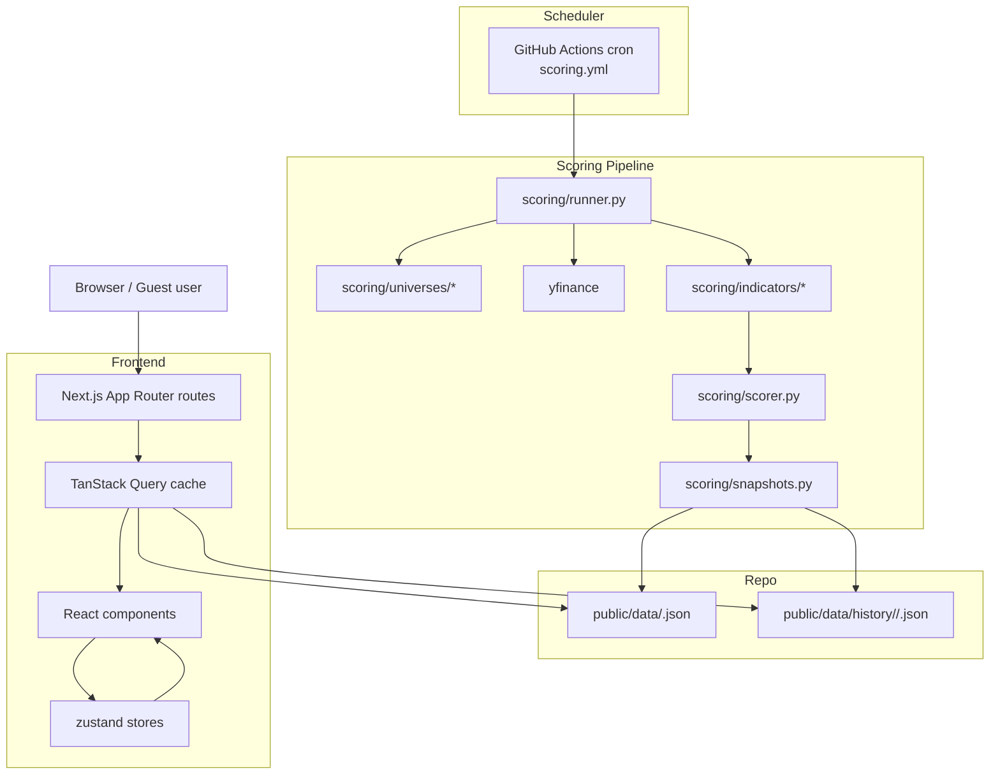

# Architecture Documentation: TechTracker

## 1. Overview

TechTracker is a technical-analysis dashboard that screens 15 asset universes (US equities, sector / industry / country ETFs, currencies, commodities, India / Hong Kong / Singapore / Japan / Europe equities, fixed income, broad-market and growth/value funds) against 9 technical indicators (MA Trend, MACD, RSI, ADX/DMI, SAR, Bollinger, Stochastic, OBV, Ichimoku), produces a weighted 0–10 composite score per instrument, and maps that score to a five-level signal (Strong Buy / Buy / Neutral / Sell / Strong Sell).

It is a **close replica** of https://st-technical-analysis.lovable.app. Discovery captured 15 use cases (`UC-01` … `UC-15`) which drive the implementation plan (see [`docs/replicate/IMPLEMENTATION_ROADMAP.md`](../replicate/IMPLEMENTATION_ROADMAP.md)).

Goals:

1. Visual + feature parity with the source across every screener, Signals Hub, Signal Change, Portfolio Builder, Analytics, and Methodology tab.
2. Reliable offline scoring via a Python pipeline that publishes JSON snapshots every weekday.
3. Zero server operational cost at rest — static hosting for the frontend, scheduled jobs for the scoring pipeline.
4. Sufficient separation of concerns that individual indicators, universes, and UI views can be evolved independently.

Non-goals (explicitly **not** building):

- Authentication, accounts, multi-tenancy.
- Server-side persistence of user state (portfolios and weight presets live in `localStorage`).
- Real-time / streaming price data. Scores refresh at a cadence driven by the scheduled job.
- Order execution, brokerage integration, or anything resembling financial advice.

## 2. Tech Stack Choices

### Frontend

| Category | Choice | Rationale |
| :--- | :--- | :--- |
| **Language** | TypeScript (strict) | Catches column-schema drift early; encodes the domain model from [`data-models.md`](../replicate/reports/data-models.md) as types. |
| **Framework** | Next.js 15 (App Router) + React 19 | SSG/ISR lets us serve screeners fast without shipping full datasets upfront; mature RSC boundary for interactive table islands; first-class Vercel deploy. |
| **Styling** | Tailwind CSS 4 | Matches source look-and-feel; Lovable used Tailwind. Keeps component code compact. |
| **Component library** | shadcn/ui (Radix primitives) | Direct parity with source (Radix dialog, tabs, slider). Copy-paste model keeps customisation in-tree. |
| **Icons** | lucide-react | Same icon set as source (`v0.462.0` observed). |
| **Charts** | Recharts | Same lib as source — exact visual parity on Analytics + ticker detail modal. |
| **Table** | @tanstack/react-table | Declarative sort/filter for 13 screener variants with differing column sets. |
| **Server state** | @tanstack/react-query | Cache + background refresh of snapshot JSON; disables SSR waterfalls. |
| **Client state** | zustand | Portfolio holdings, active weight preset, saved presets, persisted theme. Lightweight and test-friendly. |
| **Theme** | hand-rolled bootstrap script + `useSyncExternalStore` hook | Owned in `src/components/shell/theme-provider.tsx` + `theme-toggle.tsx`. `next-themes` was the initial choice but its Provider did not hydrate under Next 16 + Turbopack during #2; the 50-line primitive is deterministic and small enough to own. Respects `prefers-color-scheme`; persists to `localStorage['theme']`; cross-tab sync via `storage` event. |
| **Testing** | Vitest (unit), Playwright (E2E), Storybook (component visual) | Vitest ships with Vite/Next; Playwright already proven during discovery; Storybook lets us diff against replication screenshots. |
| **Linting** | ESLint + Prettier + TypeScript strict | Standard Next.js defaults. |

### Backend / scoring pipeline

| Category | Choice | Rationale |
| :--- | :--- | :--- |
| **Language** | Python 3.11+ | Closest match to the source's documented CLI (`python sp500_technical_framework.py`); pandas-ta ecosystem is mature. |
| **Market data** | yfinance | Ticker suffixes observed in source (`.NS`, `.T`, `.L`, `.HK`, `=F`, `=X`) map directly to Yahoo symbols. No API key. |
| **Indicator maths** | pandas, pandas-ta, numpy | Canonical implementations of MA/MACD/RSI/etc. Keeps our code a scoring layer, not an indicator library. |
| **Packaging** | pyproject.toml + uv or pip | Single `scoring/` package; pure functions per indicator. |
| **Scheduler** | GitHub Actions cron | Free on public/private GitHub repos; artifacts committed to `/public/data/*.json` on the default branch; also supports manual dispatch. |
| **Test** | pytest + fixtures | Deterministic OHLCV fixtures per indicator assert score stability. |

### Hosting & delivery

| Category | Choice | Rationale |
| :--- | :--- | :--- |
| **Frontend hosting** | Vercel | Zero-config Next.js; preview URLs per PR; edge caching for `/public/data/*.json`. |
| **Snapshot storage** | Repo-committed JSON under `public/data/` (current + 35-day history under `public/data/history/<universe>/<YYYY-MM-DD>.json`) | Keeps deploys reproducible; Git is the durable store; no external dependency. Re-evaluate if repo grows beyond ~200 MB. |
| **CI** | GitHub Actions | `ci.yml` (lint + type-check + vitest + playwright-smoke) and `scoring.yml` (scheduled cron + manual dispatch). |
| **Observability** | Vercel analytics + GitHub Actions logs | Low-cost baseline; revisit if SLOs harden. |

## 3. Architectural Layers

### 3.1. Presentation layer (Next.js)

- **Responsibility**: Rendering every visible view — screeners, ticker detail modal, Signals Hub, Signal Change, Portfolio Builder, Analytics, Methodology, shell (header, tab bar, theme toggle, status line).
- **Key modules**:
  - `src/app/` — App Router routes. One route group per universe (`/(screener)/stocks`, `/(screener)/sector-etfs`, …), plus `/(tools)/portfolio`, `/(tools)/signals`, `/(tools)/signal-change`, `/(tools)/analytics`, `/(tools)/methodology`.
  - `src/components/shell/` — `AppHeader`, `TabBar`, `StatusLine`, `ThemeToggle`.
  - `src/components/screener/` — `ScreenerTable`, `KpiCardRow`, `FilterChipRow`, `TrendSparkline`, `SignalBadge`, `IndicatorScoreCell`.
  - `src/components/detail/` — `TickerDetailModal`, `TimeframeTabs`, `ChartKindTabs`, `IndicatorRadar`.
  - `src/components/signals/` — `UniverseStatCard`, `SignalChangeCard`, `SignalChangeTable`, `SpotlightCardGrid`.
  - `src/components/portfolio/` — `ModelPortfolioCard`, `PortfolioPanel`, `AddAssetButton`.
  - `src/components/analytics/` — `SignalDistributionBarChart`, `SectorAverageScoreBarChart`, `ScoreDistributionHistogram`.
  - `src/components/methodology/` — `WeightPresetChips`, `WeightSliderGroup`.
  - `src/components/ui/` — shadcn/ui primitives (Dialog, Tabs, Slider, Button, Card, Input, etc.).

### 3.2. Client state & data layer

- **Responsibility**: Feeding components the data they need; caching; persisting user choices across sessions.
- **Key modules**:
  - `src/stores/portfolio.ts` (zustand) — holdings, weighting mode, derived composite.
  - `src/stores/weights.ts` (zustand + persist middleware) — active preset, user-saved presets (max 5).
  - `src/stores/theme.ts` (next-themes wrapper).
  - `src/queries/snapshots.ts` (TanStack Query) — `useUniverseSnapshot(universe)`, `useAllUniverses()`, `useTickerHistory(ticker, timeframe)`.
  - `src/lib/fetchers.ts` — thin `fetch` wrappers over `/data/<universe>.json` and `/data/history/<universe>/<date>.json`.

### 3.3. Domain layer

- **Responsibility**: Pure functions that turn raw indicator values into scores and signals. Consumed identically by the Python pipeline (via a shared contract) and the UI (for "what if I change weights?" recomputation).
- **Key modules (TypeScript)**:
  - `src/domain/bands.ts` — `signalForScore(score: number): Signal` using the 5-band map from UC-11.
  - `src/domain/composite.ts` — `compositeScore(indicators, weights): number` normalising weights to 100.
  - `src/domain/types.ts` — every interface in [`data-models.md`](../replicate/reports/data-models.md).
  - `src/domain/filters.ts` — chip-row + search intersections for the screener.
- **Key modules (Python, mirrored)**:
  - `scoring/domain/bands.py`, `scoring/domain/composite.py` — same rules as TS; enforced by a contract test that imports a shared JSON fixture.

### 3.4. Integration layer (scoring pipeline)

- **Responsibility**: Fetch market data, compute indicator scores, publish per-universe JSON snapshots, and retain a rolling 35-day history for UC-07.
- **Key modules (Python)**:
  - `scoring/universes/` — one module per universe with ticker lists + chip metadata.
  - `scoring/indicators/` — one pure function per indicator; each returns `{score: float, series: pd.Series}`.
  - `scoring/scorer.py` — applies active weight preset, derives signal, outputs an `Instrument` dict.
  - `scoring/runner.py` — orchestrates fetch → score → write; single entry point consumed by CI.
  - `scoring/snapshots.py` — writes `public/data/<universe>.json` + `public/data/history/<universe>/<date>.json`; prunes history beyond 35 days.

## 4. Key Components & Modules

### 4.1 `scoring/runner.py`

Single-command pipeline entry. Steps:

1. Resolve the universe matrix (`--universe` flag; default = all).
2. For each universe: load tickers → fetch OHLCV via yfinance (daily closes, configurable window) → compute 9 indicator series → normalise to 0–10 scores → apply active weight preset → derive signal.
3. Hand off to `snapshots.write_snapshot(universe, instruments)` which emits current + history files.
4. Exit non-zero on any universe failure; emit a per-universe summary to stdout for Actions logs.

### 4.2 `src/components/screener/ScreenerTable`

The workhorse table for all 13 screener universes (UC-01 … UC-04).

- Takes `universe: Universe` prop; selects column set from a per-universe schema map.
- Wraps `@tanstack/react-table`; sort state is URL-backed.
- Row `onClick` opens `TickerDetailModal` via shared modal context (UC-05).
- Search and chip state live in local URL query string so they survive back/forward.

### 4.3 `src/components/detail/TickerDetailModal`

Opened from any row (every screener; Signals Hub spotlight cards).

- Uses Radix Dialog primitives via shadcn.
- `TimeframeTabs` × `ChartKindTabs` drives which Recharts chart renders.
- `IndicatorRadar` reads from the active weight preset (UC-11) so recomputed composites appear without a page reload.

### 4.4 `src/stores/weights.ts`

Source of truth for indicator weights.

- Defaults from methodology (MA 18 / MACD 15 / ADX 13 / RSI 12 / SAR 10 / Boll 10 / Stoch 10 / OBV 7 / Ichi 5).
- Four built-in presets (Default, Momentum Focus, Trend Following, Mean Reversion).
- Up to 5 user slots persisted via zustand's `persist` middleware to `localStorage`.
- Exposes `useActiveWeights()`, `useActivePresetId()`, `savePresetAsCurrent(name)`.

### 4.5 `src/domain/bands.ts`

Single module that converts score → signal. The same rules live in `scoring/domain/bands.py`; a contract test (`scoring/tests/test_contract.py`) asserts both return identical outputs for the full 0–10 range.

## 5. Data Flow

From scheduled run to browser render:

1. **Scheduler** — `scoring.yml` runs 30 min after US market close on weekdays (configurable). Manual dispatch always available.
2. **Fetch** — `runner.py` asks `yfinance` for OHLCV per universe ticker list. Rate-limits handled with backoff; failures on any single ticker are logged but don't abort the universe.
3. **Compute** — each `scoring/indicators/*.py` returns a 0–10 score plus the raw series. `scorer.py` applies the default weights to produce the composite; `bands.py` maps composite → signal.
4. **Publish** — `snapshots.py` writes the per-universe JSON to `public/data/<universe>.json` and copies it into `public/data/history/<universe>/<today>.json`; prunes history older than 35 days.
5. **Commit** — Actions job commits the changed artifacts on `main` with `[scoring] <date>` commit message, triggering Vercel re-deploy.
6. **Cache** — Vercel edge caches `public/data/**` with short TTL; browsers hit the edge.
7. **Hydrate** — Next.js route loads; TanStack Query fetches the relevant snapshot; components read from cache, apply client-side filters/sort/search.
8. **Re-score on demand** — user changes weight preset on Methodology → `useActiveWeights()` changes → `compositeScore` recomputes in-place for every component reading it. No network.

### 5.1 Signal Change (UC-07) flow

1. TanStack Query fetches the current snapshot **and** the snapshot at `today − lookback` from the history directory.
2. `src/lib/diff.ts` joins by ticker, returning rows whose `signal` changed; exposes counts per universe.
3. Rendered in `SignalChangeTable` with `Previous Signal → Current Signal` columns.

## 6. Design Patterns & Principles

- **Pure domain layer, duplicated intentionally** — scoring maths exists in both TS and Python, gated by a contract test. Avoids a WASM bridge or RPC for what is a small, stable rule set.
- **Snapshot-first architecture** — the frontend has no backend; the scoring pipeline produces immutable per-day artifacts. Reproducibility and backtesting are trivial.
- **URL as state for screener views** — sort, search, chip, and selected universe live in the URL so deep links round-trip.
- **Localstorage-first user state** — no accounts means the user's portfolio + weight presets survive via `zustand/middleware/persist`. Upgrade path to a backend exists (replace persist storage with a server-sync adapter) but is out of scope.
- **One FRAIM issue per UC** — every feature ships behind its own spec → design → implement chain. See [`CONTRIBUTING.md`](../CONTRIBUTING.md).
- **Explicit universe schemas** — the per-universe column and chip configuration is a single typed map; adding a universe is a config change, not a code change.

## 7. Configuration & Environment

- **FRAIM Config**: Located at `.fraim/config.json`. Updated by phase 4 of this job to set `customizations.architectureDoc = "docs/architecture/architecture.md"`.
- **Environment variables**:
  - `YFINANCE_CACHE_DIR` (optional) — local cache to speed up dev runs.
  - `SCORING_UNIVERSES` (CI optional) — comma-separated universes to restrict a run; default = all.
  - `TZ=America/New_York` — used by the scheduler for market-close anchoring.
  - No secrets required at runtime; GitHub Actions uses the built-in `GITHUB_TOKEN` for the commit-back step.
- **Build**: `pnpm build` (Next.js) + `python -m scoring.runner` (ad-hoc) + `uv run pytest` (or `pytest`) for Python tests.
- **Deploy**: Vercel auto-deploys `main`; scoring commits are just another push.

## 8. Open questions (to be resolved in downstream RFCs)

- Does the source auto-refresh on a timer? (UC-13) — default to hard-reload only until evidence says otherwise.
- Snapshot size budget — single-file `public/data/*.json` is fine up to a few MB; if we embed historical per-ticker daily closes for the detail modal (UC-05), that grows fast. Option: lazy-fetch per-ticker history from `public/data/history/ticker/<SYM>.json`.
- Should `Analytics` (UC-10) expose a universe picker or stay fixed on Top 50? Source behaviour ambiguous.
- Portfolio Builder's `Portfolio ETFs` pseudo-universe (32 instruments surfaced on Signals Hub) — where does its ticker list live? Proposal: `scoring/universes/portfolio_etfs.py` — a curated UCITS ETF list used both as the candidate table in UC-09 and as its own Signals Hub card.
